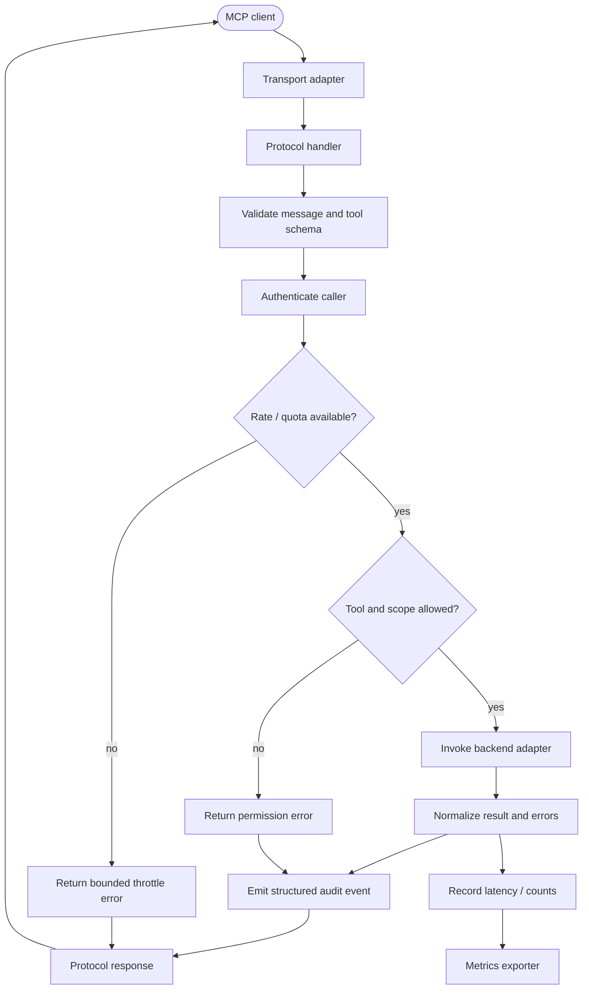

# x4-mcp-prod

**Production-grade MCP gateway**: registry, authentication, permissions, schema validation, rate limits, and audit logging.

Ready for multi-agent fleets. Complements the lighter `x4-mcp` / `x4-mcpgen` tools.

## Features

- Explicit tool allow-lists (no `*`)
- Per-client rate limiting
- Schema validation on every call
- Audit trail compatible with x4-evidence
- stdio + HTTP transports

## Quick Start

```bash
pip install -e ".[dev]"
x4-mcp-prod serve --config config/example.yml
```

## License

Apache-2.0

## APEX Architecture Map

> Status: architecture documentation; implementation and deployment claims require independent verification.


**Evidence note:** The diagram describes production-oriented target controls. Verify transport, authentication, quotas, metrics, and backend adapters before describing the server as production-ready.

