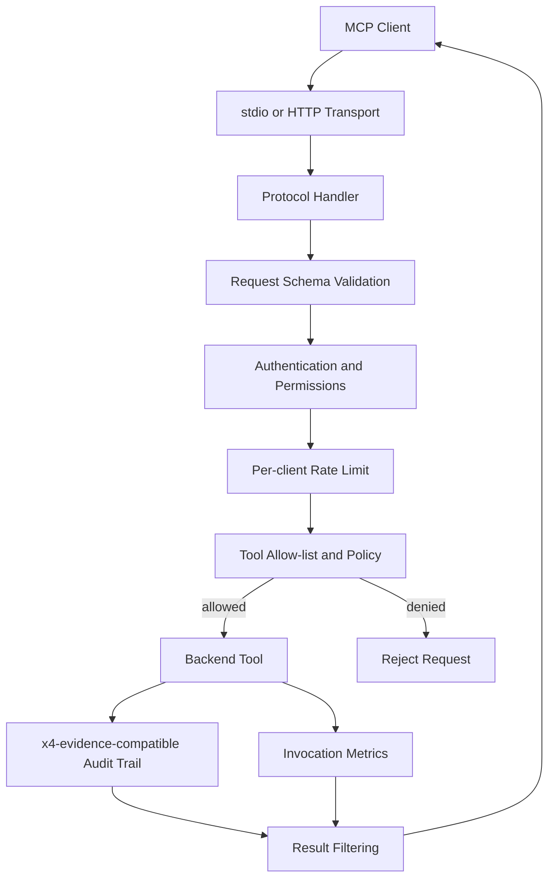

# x4-mcp-prod

**Production-grade MCP gateway**: registry, authentication, permissions, schema validation, rate limits, and audit logging.

Ready for multi-agent fleets. Complements the lighter `x4-mcp` / `x4-mcpgen` tools.

## Features

- Explicit tool allow-lists (no `*`)
- Per-client rate limiting
- Schema validation on every call
- Audit trail compatible with x4-evidence
- stdio + HTTP transports

<!-- X4-APEX-DIAGRAM-START:x4-mcp-prod -->



<!-- X4-APEX-DIAGRAM-END:x4-mcp-prod -->

## Quick Start

```bash
pip install -e ".[dev]"
x4-mcp-prod serve --config config/example.yml
```

## License

Apache-2.0
